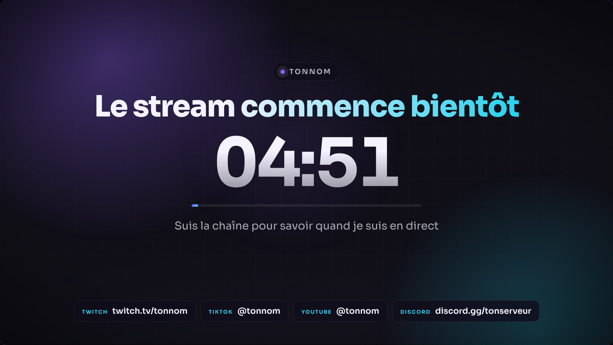
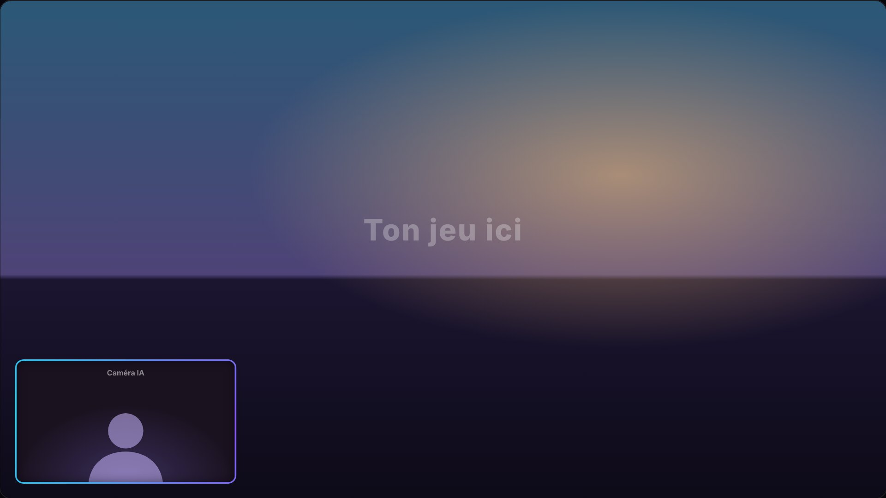
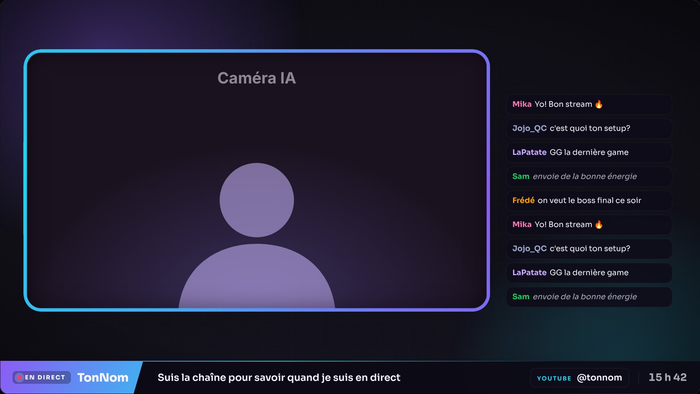
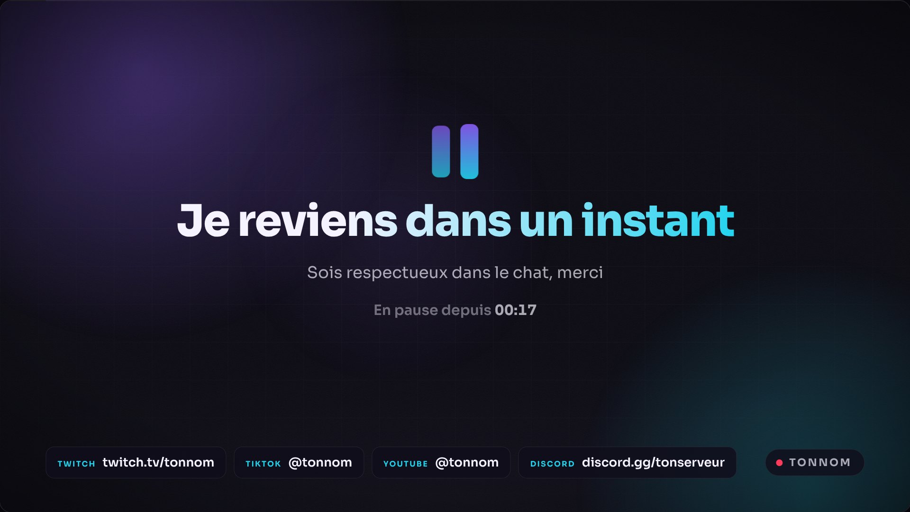
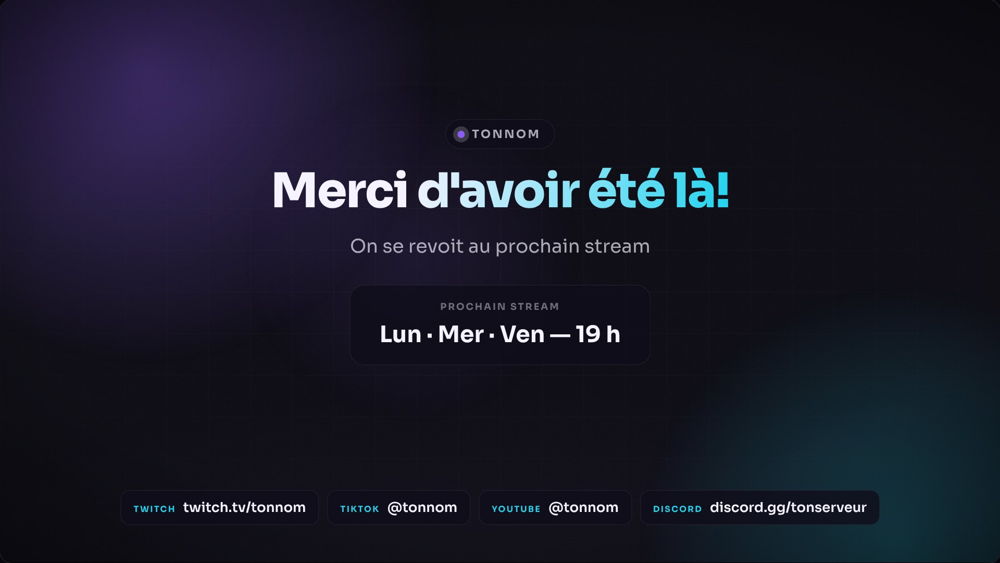

# StreamSetup : ton setup OBS complet

Tout est déjà monté : 5 scènes, des écrans animés, le micro réglé, des raccourcis clavier et un emplacement prêt pour ta caméra IA. Tu modifies un seul fichier pour mettre ton nom, tes couleurs et tes réseaux.

| Début | En jeu | Discussion |
|---|---|---|
|  |  |  |

| Pause | Fin |
|---|---|
|  |  |

*Dans ces aperçus, le jeu et la caméra sont des exemples.*

---

## 1. Installation (10 minutes)

1. **Copie le dossier.** Mets le dossier `StreamSetup` directement dans `C:\`. Tu dois obtenir `C:\StreamSetup\overlays\debut.html`. Ce chemin est important : la collection de scènes pointe vers lui.
2. **Mets tes infos.** Ouvre `C:\StreamSetup\overlays\config.js` avec le Bloc-notes. Change ton nom, tes couleurs, tes réseaux, ton horaire et tes messages, puis enregistre.
3. **Vérifie le résultat.** Double-clique sur `C:\StreamSetup\apercu.html` : tes 5 scènes s'affichent dans ton navigateur. Actualise avec F5 après chaque changement dans `config.js`.
4. **Importe les scènes dans OBS.** Menu **Collection de scènes > Importer**. Clique sur `…`, choisis `C:\StreamSetup\obs\StreamSetup.json`, coche la ligne, puis clique sur **Importer**. Ensuite, menu **Collection de scènes > StreamSetup**.
5. **Règle OBS** avec la section 2 ci-dessous.

> **Tu as mis le dossier ailleurs que dans `C:\` ?** OBS ouvre une fenêtre « Fichiers manquants » : clique sur **Rechercher dans un dossier** et choisis ton dossier `StreamSetup`. Sinon, double-clique sur chaque source « navigateur » et choisis le bon fichier.

---

## 2. Réglages OBS (Fichier > Paramètres)

Commence par **Outils > Assistant de configuration automatique** (choisis « Optimiser pour le streaming »), puis vérifie ces valeurs.

### Vidéo
| Réglage | Valeur |
|---|---|
| Résolution de base (canevas) | **1920 × 1080**, obligatoire : tout l'habillage est placé pour cette taille |
| Résolution de sortie | selon ta plateforme (tableau plus bas) |
| Filtre de mise à l'échelle | Lanczos |
| Images par seconde | 60 |

### Sortie (mode **Avancé**, onglet Streaming)
Choisis l'encodeur selon ta carte graphique :

| Ta carte graphique | Encodeur | Réglages |
|---|---|---|
| **NVIDIA** (GTX 16xx, RTX) | NVIDIA NVENC H.264 | CBR · intervalle d'images clés 2 s · préréglage **P5** · réglage « Haute qualité » · multipasse « Deux passes (quart de résolution) » · profil high · images B max : 2 |
| **AMD** (RX 6000 / 7000 / 9000) | AMD HW H.264 (AVC) | CBR · images clés 2 s · préréglage « Qualité » · profil high |
| **Intel Arc** | QuickSync H.264 | CBR · images clés 2 s · préréglage « Qualité » |
| Pas de carte graphique | x264 | CBR · images clés 2 s · préréglage « veryfast » (demande beaucoup au processeur) |

Choisis ensuite le débit selon ta plateforme :

| Plateforme | Résolution de sortie | Débit vidéo |
|---|---|---|
| **Twitch** | 1664 × 936 à 60 i/s (1920 × 1080 si ton jeu bouge peu) | 6000 kbps |
| **YouTube** | 1920 × 1080 à 60 i/s | 9000 à 12 000 kbps |
| **Kick** | 1920 × 1080 à 60 i/s | 8000 kbps |

- **Règle d'or :** ton débit vidéo ne doit pas dépasser **75 % de ta vitesse d'envoi**. Fais un test sur speedtest.net et regarde « Upload ». Avec 8 Mbps d'envoi, reste à 6000 kbps.
- **Twitch avec une carte NVIDIA :** dans **Paramètres > Stream**, essaie « Diffusion améliorée » (Enhanced Broadcasting). OBS règle alors la qualité tout seul et envoie plusieurs qualités à Twitch.

### Audio
- Fréquence d'échantillonnage : **48 kHz**.
- Débit audio (onglet Sortie > Audio) : **160 kbps**.

### Enregistrement (pour tes clips et tes vidéos)
- Format : **MP4 hybride** s'il est offert, sinon **MKV** en cochant « Convertir automatiquement en MP4 ». Avec ces formats, tu ne perds pas ton enregistrement si OBS plante.
- Encodeur : « Utiliser l'encodeur du stream », pour ne pas charger la carte graphique deux fois.

### Avancé
- Priorité du processus : **Au-dessus de la normale**.
- Lance OBS **en tant qu'administrateur** (clic droit sur l'icône). La capture de jeu est plus fiable et OBS garde sa priorité sur la carte graphique quand le jeu est lourd.
- Laisse le **mode Studio désactivé** : sinon les raccourcis de scène changent l'aperçu au lieu du direct.

---

## 3. Les scènes et les raccourcis

Les raccourcis fonctionnent même quand tu es dans ton jeu.

| Raccourci | Action |
|---|---|
| `Ctrl + Alt + 1` | **Début** : compte à rebours, messages, réseaux |
| `Ctrl + Alt + 2` | **En jeu** : ton jeu plein écran avec la caméra IA en bas à gauche |
| `Ctrl + Alt + 3` | **Discussion** : grande caméra, chat et bandeau |
| `Ctrl + Alt + 4` ou `Ctrl + Alt + P` | **Pause** : touche panique, l'écran « Je reviens » s'affiche |
| `Ctrl + Alt + 5` | **Fin** : remerciements, prochain stream, réseaux |
| `Ctrl + Alt + C` | Cache ou réaffiche la **caméra**, instantanément |
| `Ctrl + Alt + M` | Coupe ou réactive le **micro** |

Pour changer un raccourci : **Paramètres > Raccourcis clavier**.

**Bon à savoir**
- Toutes les sources sont **verrouillées** pour éviter de les déplacer par erreur. Pour en bouger une, clique sur le cadenas à côté de son nom.
- La scène **[Source] Caméra** n'est pas une scène à montrer : c'est ta caméra avec son cadre. Elle est réutilisée dans « En jeu » et « Discussion ». Si tu la modifies une fois, les deux scènes changent.
- Dans « En jeu », le **chat** et le **bandeau** sont cachés : clique sur l'œil pour les afficher.
- Le jeu ne s'affiche pas ? Cache « Jeu » et affiche « Jeu (fenêtre) », puis choisis la fenêtre de ton jeu.

---

## 4. La caméra IA

> **Règle absolue : n'ajoute jamais ta Elgato Facecam dans OBS.** Seul ton logiciel d'IA la lit. Comme OBS ne voit jamais ta vraie face, il ne peut pas la diffuser par erreur.

La scène **[Source] Caméra** contient deux emplacements. Utilise celui qui correspond à ton logiciel.

**A. Le logiciel affiche une fenêtre d'aperçu (Deep-Live-Cam, par exemple)**
1. Ouvre ton logiciel d'IA et lance l'aperçu en direct.
2. Dans OBS, scène **[Source] Caméra**, double-clique sur **Caméra IA - fenêtre** et choisis la fenêtre d'aperçu.
3. S'il y a des bordures noires, déverrouille la source, puis fais glisser les bords en tenant **Alt** pour les rogner.

**B. Le logiciel crée une caméra virtuelle (Viggle LIVE, Akool, etc.)**
1. Cache **Caméra IA - fenêtre** (clique sur l'œil) et affiche **Caméra IA - caméra virtuelle**.
2. Double-clique dessus et choisis la caméra virtuelle du logiciel, **jamais « Elgato Facecam »**.

**Si l'IA bugue en direct :** `Ctrl + Alt + C` coupe la caméra instantanément. `Ctrl + Alt + P` passe à l'écran de pause.

Les coins arrondis viennent du filtre « Coins arrondis » de la scène caméra. Le cadre lumineux vient de `cadre-camera.html`, et tu peux arrêter son animation dans `config.js` (`cadre.anime: false`).

---

## 5. Le micro (déjà réglé)

Le micro utilise ton micro par défaut de Windows. Pour en choisir un autre : **Paramètres > Audio > Micro/Auxiliaire**. Quatre filtres sont déjà en place, dans cet ordre :

1. **Suppression du bruit** (RNNoise) : enlève le ventilateur, le clavier, etc.
2. **Gain** : à monter si ta voix est trop basse.
3. **Compresseur** : égalise ta voix, pour que les chuchotements et les cris aient un volume semblable.
4. **Limiteur** : empêche la saturation quand tu cries.

**Calibrage :** parle normalement et regarde le vu-mètre du micro. Ta voix doit rester dans la **zone jaune** et ne jamais atteindre le rouge. Si elle reste dans le vert, monte le filtre « 2. Gain » de 3 dB à la fois.

Si tu as une carte **NVIDIA RTX**, l'application gratuite **NVIDIA Broadcast** enlève le bruit encore mieux. Choisis alors « Micro (NVIDIA Broadcast) » comme micro et désactive le filtre 1.

**Musique :** évite Spotify en stream, sinon tes rediffusions risquent d'être coupées pour droits d'auteur. Prends une musique libre de droits pour le streaming, comme StreamBeats (gratuit).

---

## 6. Alertes et chat

**Alertes (abonnements, dons, raids) :** crée un compte gratuit sur StreamElements, puis va dans **Overlays** et crée un « AlertBox ». Copie son lien, puis dans OBS, double-clique sur la source **Alertes** et colle le lien dans « URL ». La source Alertes est déjà dans toutes les scènes.

**Chat :**
- **Twitch :** écris le nom de ta chaîne dans `config.js` (`chat.chaineTwitch`). Le chat s'affiche tout seul, sans connexion à ton compte. Les messages supprimés par tes modérateurs disparaissent aussi de l'écran, et les commandes `!` et les bots sont cachés.
- **YouTube, Kick ou TikTok :** utilise Social Stream Ninja (gratuit). Copie son lien d'overlay, double-clique sur la source **Chat**, décoche « Fichier local » et colle le lien.
- Pour placer le chat sans attendre de messages, mets `demo: true` dans `config.js`, puis remets `false`.

---

## 7. Avant chaque stream (2 minutes)

1. Ouvre ton **logiciel de caméra IA** en premier et vérifie que tout est normal : bouge la tête, mets ta main devant ta face.
2. Ouvre OBS sur la scène **Début** (`Ctrl + Alt + 1`) et parle pour vérifier le vu-mètre du micro.
3. Clique sur **Démarrer le streaming**. Pendant le compte à rebours, lance ton jeu.
4. `Ctrl + Alt + 2` quand tu es prêt.
5. À la fin : `Ctrl + Alt + 5`, fais un raid vers un autre streamer, puis arrête le stream après une minute.

---

## 8. Dépannage

| Problème | Solution |
|---|---|
| Écran noir à la place du jeu | Lance OBS en administrateur. Sinon, utilise « Jeu (fenêtre) ». Sur un portable, règle OBS pour qu'il utilise la carte graphique haute performance (Paramètres Windows > Affichage > Graphiques). |
| « Encodage surchargé » | Baisse le préréglage d'un cran (P5 → P4) ou la résolution de sortie, ou limite les images par seconde du jeu. |
| « Images perdues (réseau) » | Baisse le débit vidéo de 1000 kbps et branche ton PC avec un fil plutôt qu'en Wi-Fi. |
| Un écran (début, pause…) n'est pas à jour | Clic droit sur la source > **Actualiser**. |
| Le chat Twitch n'affiche rien | Vérifie `chat.chaineTwitch` dans `config.js` : seulement le nom, sans `twitch.tv/`. |
| Les écrans sont décalés ou coupés | Ta résolution de base n'est pas 1920 × 1080 : corrige-la dans **Paramètres > Vidéo**. |

---

## Contenu du dossier

```
StreamSetup/
├── apercu.html              aperçu des 5 scènes dans ton navigateur
├── obs/StreamSetup.json     collection de scènes à importer dans OBS
├── overlays/
│   ├── config.js            ← LE fichier à modifier (nom, couleurs, réseaux…)
│   ├── debut.html           écran de début avec compte à rebours
│   ├── pause.html           écran de pause avec minuterie
│   ├── fin.html             écran de fin
│   ├── fond.html            fond animé de la scène Discussion
│   ├── bandeau.html         bandeau du bas (1920 × 90)
│   ├── cadre-camera.html    cadre lumineux de la caméra
│   ├── chat.html            chat Twitch (480 × 720)
│   ├── style.css, commun.js code partagé
│   └── img/masque-camera.png  masque des coins arrondis
├── apercus/                 images de ce guide
└── outils/generer-collection.py  régénère la collection (dossier ailleurs que C:\)
```

Pour installer le dossier ailleurs, par exemple sur `D:\` : `python outils/generer-collection.py --dossier "D:/StreamSetup"`, puis importe le nouveau `obs/StreamSetup.json`.
